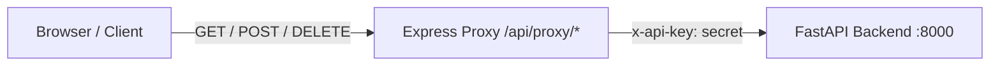

# API Endpoints Specification

This document details all REST and Server-Sent Events (SSE) endpoints provided by the
FastAPI backend (`http://localhost:8000`). `/api/v2` is the only API surface — there is no
`/api/v1` (the earlier v1 pipeline and its duplicated agent/retrieval/generation code were
removed; see the project's debloat notes).

Every endpoint below except `/api/v2/health` requires the `x-api-key` header.

- **Base Path**: `/api/v2`
- **Swagger Documentation**: `/docs`
- **ReDoc Documentation**: `/redoc`

---

## 1. Agent & Workflow Endpoints

### 1.1 `GET /api/v2/health`
No auth required. Returns `{"status": "ok", ...}`.

### 1.2 `POST /api/v2/agent/query`
Executes the multi-agent LangGraph supervisor graph for a query, synchronously.

#### Request Body
```json
{
  "query": "Compare HNSW vs IVFFlat indexing in pgvector",
  "conversation_id": "conv_9921",
  "filters": { "product": "postgresql" }
}
```

#### Response Body (`200 OK`)
```json
{
  "status": "success",
  "conversation_id": "conv_9921",
  "answer": "HNSW (Hierarchical Navigable Small World) creates a multi-layer graph [1]...",
  "sources": [
    {
      "citation_id": 1,
      "title": "pgvector.md",
      "source": "/data/documents/postgresql/pgvector.md",
      "content": "HNSW indexing creates multi-layer graph structures..."
    }
  ],
  "intent": "comparison",
  "verification_status": "VALID",
  "trace_events": [
    {"node": "memory_loader", "status": "ok"},
    {"node": "planner", "intent": "comparison"},
    {"node": "verifier", "status": "VALID"}
  ]
}
```

### 1.3 `POST /api/v2/agent/stream`
Server-Sent Events (SSE) streaming endpoint.

**Streaming contract**: `token` events carry the first attempt's answer as Qwen generates it
— the common case. If the verifier rejects that first attempt, the regenerated attempt is
*not* streamed token-by-token: it's buffered server-side and delivered as a single
`answer_replaced` event once verified. A client must, on receiving `answer_replaced`, discard
whatever it rendered from `token` events so far and show `answer_replaced.answer` as the
message's full text instead.

#### Event Stream Format (`text/event-stream`)
```http
event: status
data: {"status": "planning"}

event: token
data: {"token": "To "}

event: token
data: {"token": "configure "}

event: answer_replaced
data: {"answer": "...final verified answer...", "sources": [...]}   // only sent if the verifier retried

event: planner
data: {"intent": "single_lookup"}

event: sources
data: {"sources": [{"citation_id": 1, "title": "postgres_config.md"}]}

event: verification
data: {"verification_status": "VALID"}

event: done
data: {"status": "completed", "retry_count": 0}
```

### 1.4 `GET /api/v2/documents`
Lists ingested documents with their chunk counts.

### 1.5 `POST /api/v2/documents/ingest`
Ingests a single file from a server-local path (`{"file_path": "..."}`).

### 1.6 `POST /api/v2/documents/upload`
Uploads and ingests a markdown/text file (multipart form, field `file`).

### 1.7 `POST /api/v2/documents/sync`
Syncs a directory (`{"directory_path": "data/documents"}`): ingests new/changed files,
deletes DB records for files no longer on disk. If anything changed, also rebuilds the
GraphRAG-lite knowledge graph (see 1.9) and returns its result in the `knowledge_graph`
field of the response.

### 1.8 `DELETE /api/v2/documents/{document_id}`
Cascades deletion of a document and its indexed vector chunks. Returns `204 No Content`.

### 1.9 `POST /api/v2/documents/graph/rebuild`
Manually rebuilds the GraphRAG-lite entity/community graph (`app/graph/community_builder.py`)
without waiting for the next `/documents/sync` call. Reprocesses every indexed chunk, since
community detection is corpus-level, not per-document.

#### Response Body (`200 OK`)
```json
{
  "status": "success",
  "communities": 7,
  "chunks_processed": 142,
  "edges": 318
}
```

---

## 2. Express Server-Side Proxy Routing

All browser requests — including document upload — route through the Express proxy at
`frontend/server/index.js` (`/api/proxy/*`), which attaches the API key server-side so it
never reaches the browser bundle. In production this same process also serves the
Vite-built static SPA; in dev, Vite's own dev server proxies `/api/proxy/*` to it.


